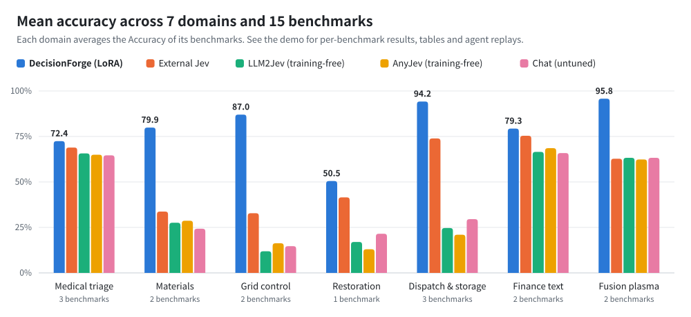

<p align="center">
  <picture>
    <source media="(prefers-color-scheme: dark)" srcset="docs/assets/brand/wordmark-dark.svg">
    
  </picture>
</p>

<p align="center"><strong>Every scenario deserves its own decision model.</strong></p>

<p align="center">
  <a href="https://blackteaxx.github.io/DecisionForge/"></a>
  <a href="docs/en/quickstart.md"></a>
  <a href="#quick-start"></a>
  
  <a href="LICENSE"></a>
  <a href="README.md"></a>
</p>

<p align="center">
  <a href="https://blackteaxx.github.io/DecisionForge/">
  <picture>
    <source media="(prefers-color-scheme: dark)" srcset="docs/assets/performance/overview-en-dark.svg">
    
  </picture>
  </a>
</p>

## What DecisionForge does

DecisionForge turns a decision scenario into a usable, evaluated decision model. Starting from the scenario and its raw materials, it builds JEV decision data, trains a native decision model, and compares it with other methods on an independent evaluation set.

| Stage | What it covers |
| --- | --- |
| **Data** | Existing JSON / TXT QA, or narrative TXT and PDF (parsed by MinerU) → Choice, Noul and Score questions. Every record passes a checker, failures get targeted repairs, and sources stay traceable |
| **Training** | Native decision models with Unsloth, ms-swift, Laya, OpenJev and other backends, with calibration, model selection and resumable runs |
| **Evaluation** | HTTP services and local models. Trained models, training-free methods (LLM2Jev, AnyJev) and external baselines are compared on the same evaluation set, with offline rescoring and benchmark plugins |
| **Agent Skills** | Five project skills connect requirements, data, training, evaluation and analysis. Each stage presents a plan and waits for your confirmation before running |

Full results, tables and replays of two real agent tasks for the seven domains above are in the [demo](https://blackteaxx.github.io/DecisionForge/). Data, configuration and reproduction notes for the medical triage task are in [examples/domain/medical_triage](examples/domain/medical_triage/README.md).

## Quick start

The fastest route is to let an agent guide you through the workflow. Clone the repository first:

```bash
git clone https://github.com/Blackteaxx/DecisionForge.git
cd DecisionForge
```

### Option 1: your own coding agent

Start Claude Code, Codex or another coding agent that supports project skills in the repository root, and describe your goal in one sentence:

```text
/dforge I want to turn my existing triage scenario into an evaluable decision task. Please check the project and inputs first.
```

Claude Code uses `/dforge`; Codex uses `$dforge`. The five skills load automatically:

| Skill | Purpose |
| --- | --- |
| `dforge` | Entry point: requirements, suitability, route and task continuation |
| `dforge-data` | Source research, input preparation, data generation and checking |
| `dforge-train` | Configure, launch, monitor and resume training |
| `dforge-eval` | Model evaluation, method comparison and offline rescoring |
| `dforge-analyze` | Analysis of data, training and evaluation results |

### Option 2: dsh + the DecisionForge plugin

If you don't have a coding agent yet, we recommend [DeepSeek Harness](https://github.com/deepseek-ai/deepseek-harness) (dsh) with the plugin bundled in this repository. It requires Node >=24.9, npm and pnpm:

```bash
npm ci --prefix extensions/dsh-decisionforge
npm run register --prefix extensions/dsh-decisionforge
npm start --prefix extensions/dsh-decisionforge
```

Choose an agent model in settings, then type `/dforge`. See the [Agent guide](docs/en/agent.md) for installation details, workspaces and task continuation.

## Installation

Agents check and install the environment as needed; you can also install it manually and use the CLI directly. DecisionForge requires **Python >=3.11** (3.12 by default) and uses [uv](https://docs.astral.sh/uv/getting-started/installation/):

```bash
uv sync
uv run dforge --help
```

The base environment covers data generation, checking, export and HTTP evaluation. Install heavy dependencies as needed:

| Install | Purpose |
| --- | --- |
| `uv sync --extra pdf` | MinerU PDF parsing |
| `uv sync --extra eval-data` | Parquet benchmarks |
| `uv sync --extra eval-anyjev` / `eval-llm2jev` | Local training-free evaluation |
| `uv sync --extra train-unsloth` / `train-unsloth-full` | Unsloth LoRA / full fine-tuning |
| `uv sync --extra train-swift` / `train-laya` / `train-openjev` | Other training backends |
| `uv sync --group dev` | Development and tests |

Training extras are mutually exclusive; use a separate environment for each. GPU routes mainly target Linux; the base workflow supports Linux, Windows and macOS.

To verify the installation, run this offline check. It needs no API key and makes no model calls:

```bash
uv run dforge data inspect --config configs/offline.yaml
```

Before generating, copy `.env.example` to `.env` and set `OPENAI_API_KEY`, `OPENAI_MODEL` and optionally `OPENAI_BASE_URL` (generation calls models and incurs costs):

```bash
uv run dforge data build --config configs/default.yaml
uv run dforge data export --run-dir outputs/run_001 --format jsonl
```

`uv run dforge doctor` reports installed extras, `.env`, GPU and MinerU availability.

## Documentation

| Guide | Contents |
| --- | --- |
| [Quick start](docs/en/quickstart.md) | Installation, offline example and dependency groups |
| [Data generation](docs/en/data-generation.md) | Inputs, question types, concurrency, budgets and recovery |
| [Training](docs/en/training.md) | Backends, data isolation, artifacts and recovery |
| [Evaluation](docs/en/evaluation.md) | Methods, metrics, rescoring and comparison |
| [JEV format](docs/en/jev-format.md) | Request and supervision contract |
| [Agent](docs/en/agent.md) | Coding agents, the dsh plugin and skills |
| [Extending](docs/en/extending.md) | Benchmarks, metrics and development |
| [FAQ](docs/en/faq.md) | Environment, interfaces and troubleshooting |

## Acknowledgements

Thanks to these projects:

- [MinerU](https://github.com/opendatalab/MinerU): PDF parsing
- [DeepSeek Harness](https://github.com/deepseek-ai/deepseek-harness): agent interface
- Training frameworks: [Unsloth](https://github.com/unslothai/unsloth), [ms-swift](https://github.com/modelscope/ms-swift), [Laya](https://github.com/NandhaKishorM/laya), [openjev-rlcd](https://github.com/ZimmyGao/openjev-rlcd)
- Training-free frameworks: [AnyJev](https://github.com/nokia-applied-research/AnyJev), [LLM2Jev](https://github.com/Yinsongxu/LLM2Jev)

## License

Code is licensed under [Apache-2.0](LICENSE); upstream dependencies, data and models keep their own licenses. See [CONTRIBUTING](CONTRIBUTING.en.md) to contribute.
