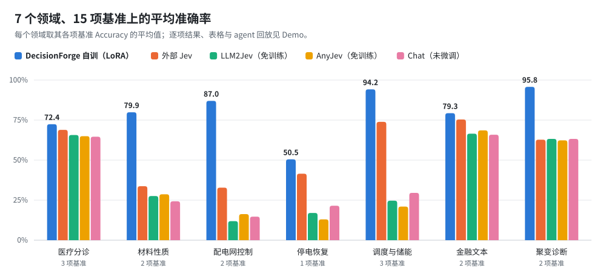

<p align="center">
  <picture>
    <source media="(prefers-color-scheme: dark)" srcset="docs/assets/brand/wordmark-dark.svg">
    
  </picture>
</p>

<p align="center"><strong>每个场景，都值得一个决策模型</strong></p>

<p align="center">
  <a href="https://blackteaxx.github.io/DecisionForge/">Demo</a> ·
  <a href="docs/zh/quickstart.md">快速开始</a> ·
  <a href="#文档">文档</a> ·
  <a href="README.en.md">English</a>
</p>

<p align="center">
  <picture>
    <source media="(prefers-color-scheme: dark)" srcset="docs/assets/performance/overview-zh-dark.svg">
    
  </picture>
</p>

## DecisionForge 能做什么

DecisionForge 把一个决策场景变成可用、可评测的决策模型：从场景和原始材料出发，构造 JEV 决策数据，训练原生决策模型，并在独立评测集上与其他方法比较。

| 环节 | 内容 |
| --- | --- |
| **数据** | 已有 JSON / TXT 问答，或 TXT、PDF（MinerU 解析）叙述材料 → Choice、Noul、Score 三种题型；每条样本经 checker 检查，失败时定向修复，来源可追溯 |
| **训练** | Unsloth、ms-swift、Laya、OpenJev 等后端训练原生决策模型，支持校准、选模与断点恢复 |
| **评测** | HTTP 服务与本地模型；自训模型、免训练方法（LLM2Jev、AnyJev）和外部基线在同一评测集上对比，支持离线重评分和 benchmark 插件 |
| **Agent Skills** | 五个项目 skills 串起需求澄清、数据、训练、评测与分析；每个阶段先给方案、等你确认再执行 |

上图七个领域的完整结果、表格和两次真实任务的 agent 回放见 [Demo](https://blackteaxx.github.io/DecisionForge/)；医疗分诊任务的数据、配置与复现说明见 [examples/domain/medical_triage](examples/domain/medical_triage/README.md)。

## 快速上手

最快的方式是让 agent 带你完成整个流程。先获取仓库：

```bash
git clone https://github.com/Blackteaxx/DecisionForge.git
cd DecisionForge
```

### 方式一：使用你自己的 coding agent

在仓库根目录启动 Claude Code、Codex 等支持项目 skills 的 coding agent，用一句话说出需求：

```text
/dforge 我想把现有的分诊场景整理成可评测的决策任务，请先核查项目和输入。
```

Claude Code 使用 `/dforge`，Codex 使用 `$dforge`。五个 skills 会自动加载：

| Skill | 用途 |
| --- | --- |
| `dforge` | 入口：需求澄清、适用性判断、路线与任务接续 |
| `dforge-data` | 来源研究、输入整理、数据生成与检查 |
| `dforge-train` | 配置、启动、跟进与恢复训练 |
| `dforge-eval` | 模型评测、方法比较与离线重评分 |
| `dforge-analyze` | 数据、训练与评测结果分析 |

### 方式二：dsh + DecisionForge 插件

如果你还没有自己的 coding agent，推荐使用 [DeepSeek Harness](https://github.com/deepseek-ai/deepseek-harness)（dsh）加仓库自带的插件。需要 Node >=24.9、npm 和 pnpm：

```bash
npm ci --prefix extensions/dsh-decisionforge
npm run register --prefix extensions/dsh-decisionforge
npm start --prefix extensions/dsh-decisionforge
```

在设置中选择 Agent 模型后输入 `/dforge`。安装细节、工作区与任务接续见 [Agent 指南](docs/zh/agent.md)。

## 安装

agent 会按需检查和安装环境；也可以手动安装后直接使用命令行。要求 **Python >=3.11**（默认 3.12），使用 [uv](https://docs.astral.sh/uv/getting-started/installation/) 管理环境：

```bash
uv sync
uv run dforge --help
```

基础环境包含数据生成、检查、导出和 HTTP 评测。重依赖按需安装：

| 安装 | 用途 |
| --- | --- |
| `uv sync --extra pdf` | MinerU PDF 解析 |
| `uv sync --extra eval-data` | Parquet 格式的 benchmark |
| `uv sync --extra eval-anyjev` / `eval-llm2jev` | 本地免训练方法评测 |
| `uv sync --extra train-unsloth` / `train-unsloth-full` | Unsloth LoRA / 全参数微调 |
| `uv sync --extra train-swift` / `train-laya` / `train-openjev` | 其他训练后端 |
| `uv sync --group dev` | 开发与测试 |

训练组之间互斥，请分别建环境。GPU 路线主要面向 Linux；基础流程支持 Linux、Windows 和 macOS。

验证安装，下面的离线检查不需要 API key，也不调用模型：

```bash
uv run dforge data inspect --config configs/offline.yaml
```

正式生成前，复制 `.env.example` 为 `.env`，填写 `OPENAI_API_KEY`、`OPENAI_MODEL` 和可选的 `OPENAI_BASE_URL`（生成会调用模型并产生费用）：

```bash
uv run dforge data build --config configs/default.yaml
uv run dforge data export --run-dir outputs/run_001 --format jsonl
```

`uv run dforge doctor` 可检查已安装的依赖组、`.env`、GPU 和 MinerU 是否可用。

## 文档

| 指南 | 内容 |
| --- | --- |
| [快速开始](docs/zh/quickstart.md) | 安装、离线示例与依赖组 |
| [数据生成](docs/zh/data-generation.md) | 输入、题型、并发、预算与恢复 |
| [模型训练](docs/zh/training.md) | 后端、数据隔离、产物与恢复 |
| [评测](docs/zh/evaluation.md) | 方法、指标、重评分与比较 |
| [JEV 格式](docs/zh/jev-format.md) | 请求与监督契约 |
| [Agent](docs/zh/agent.md) | coding agent、dsh 插件与 skills |
| [扩展](docs/zh/extending.md) | benchmark、metric 与开发 |
| [常见问题](docs/zh/faq.md) | 环境、接口和故障排查 |

## 致谢

感谢以下项目：

- [MinerU](https://github.com/opendatalab/MinerU)：PDF 解析
- [DeepSeek Harness](https://github.com/deepseek-ai/deepseek-harness)：Agent 界面
- 训练框架：[Unsloth](https://github.com/unslothai/unsloth)、[ms-swift](https://github.com/modelscope/ms-swift)、[Laya](https://github.com/NandhaKishorM/laya)、[openjev-rlcd](https://github.com/ZimmyGao/openjev-rlcd)
- 免训练框架：[AnyJev](https://github.com/nokia-applied-research/AnyJev)、[LLM2Jev](https://github.com/Yinsongxu/LLM2Jev)

## License

代码采用 [Apache-2.0](LICENSE)；上游依赖、数据和模型分别适用各自的许可证。贡献方式见 [CONTRIBUTING](CONTRIBUTING.md)。
