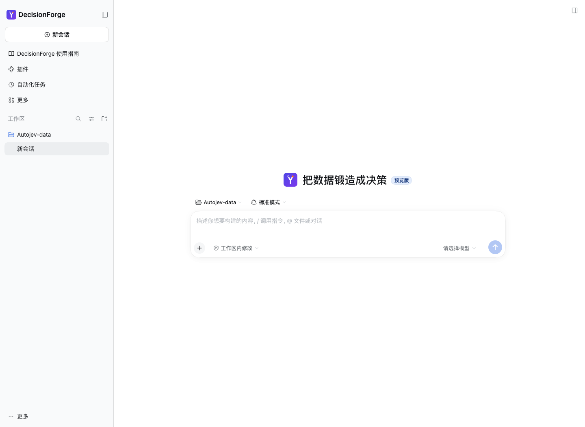
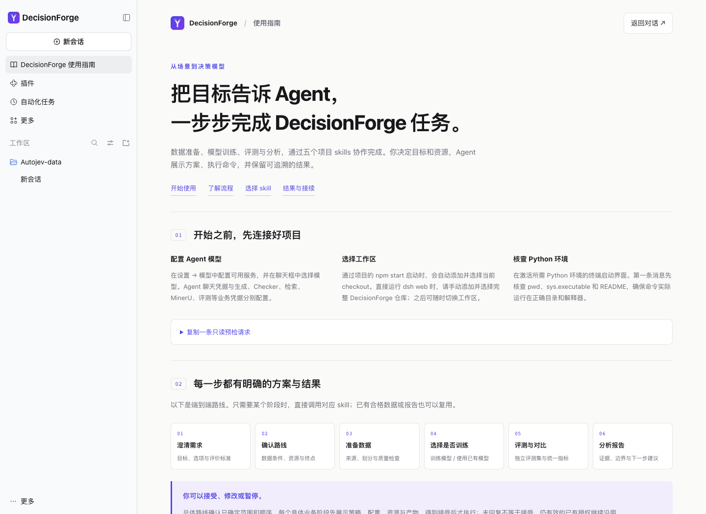

# Use with an Agent

[中文](../zh/agent.md) · [README](../../README.en.md)

Use dsh with the DecisionForge plugin, or your own coding agent inside the repository. Agent chat credentials are separate from data generation, training and evaluation credentials.

## dsh plugin

Prepare Node >=24.9, npm and pnpm on PATH, then complete [Python setup](quickstart.md). The plugin targets DeepSeek Harness 0.2.2-rc.1.

```bash
npm ci --prefix extensions/dsh-decisionforge
npm run register --prefix extensions/dsh-decisionforge
npm start --prefix extensions/dsh-decisionforge
```

Registration uses native dsh package management to install a local tarball. Normal startup does not reinstall. Use the same `DSH_HOME` and web profile for installation and startup. The project launcher adds and selects the current checkout; with standalone `dsh web`, select the full repository manually. Configure an Agent model in settings, then enter:

```text
/dforge Turn my existing scenario into an evaluable decision task. First check the project and inputs.
```



Open the guide from the sidebar or welcome Logo. It follows dsh’s Chinese/English setting and supports light/dark themes. Enable, disable or remove it through native plugin management. Disabling restores upstream branding without deleting tasks or chats. Install separately in other profiles; the package is not published to npm.



See the [plugin README](../../extensions/dsh-decisionforge/README.md) for packaging, installation and removal.

## Your own coding agent

Start Codex or Claude Code at the repository root. Five Skills live in `.agents/skills/`; Claude discovers project symlinks in `.claude/skills/`. First verify the working directory, Python interpreter and README so the agent uses this checkout.

| Skill | Task |
| --- | --- |
| `/dforge` | Requirements, suitability, route and continuation |
| `/dforge-data` | Source research, preparation, generation and checks |
| `/dforge-train` | Configure, launch, monitor and resume training |
| `/dforge-eval` | Evaluate existing models, compare and rescore |
| `/dforge-analyze` | Analyze data, training and evaluation evidence |

With existing data, freeze independent evaluation before researching training sources. With only a scenario, establish data and evaluation evidence before choosing training or existing models. A single-stage request runs only that stage.

Each business stage presents strategy, configuration, resources, budget and outputs before execution, retaining valid prior authorization. README.md and task.json under `outputs/tasks/<task>/` preserve decisions, authorization, jobs and artifacts. On resume, read records and inspect processes, manifests and outputs to avoid duplicate jobs. Stopping an Agent reply does not necessarily stop background training.

Workflow sources: [end-to-end](../assets/workflow.mmd) · [stage confirmation](../assets/stage-confirmation.mmd).
