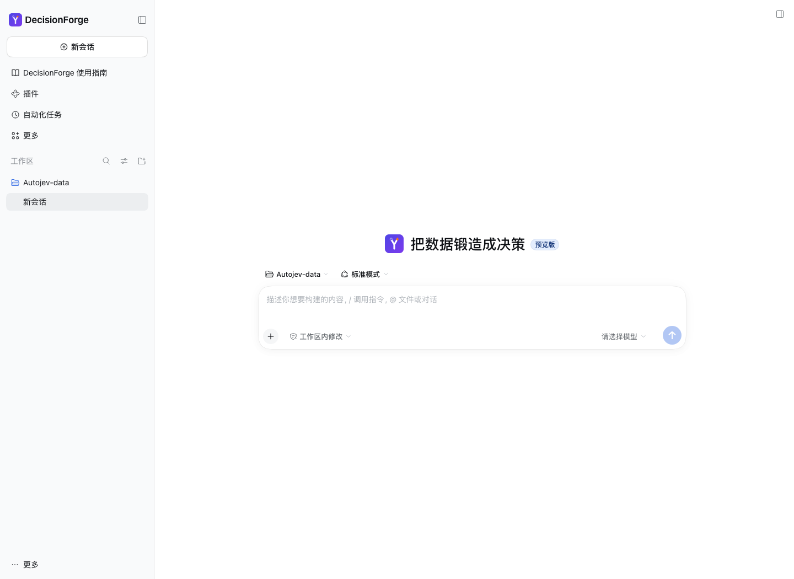
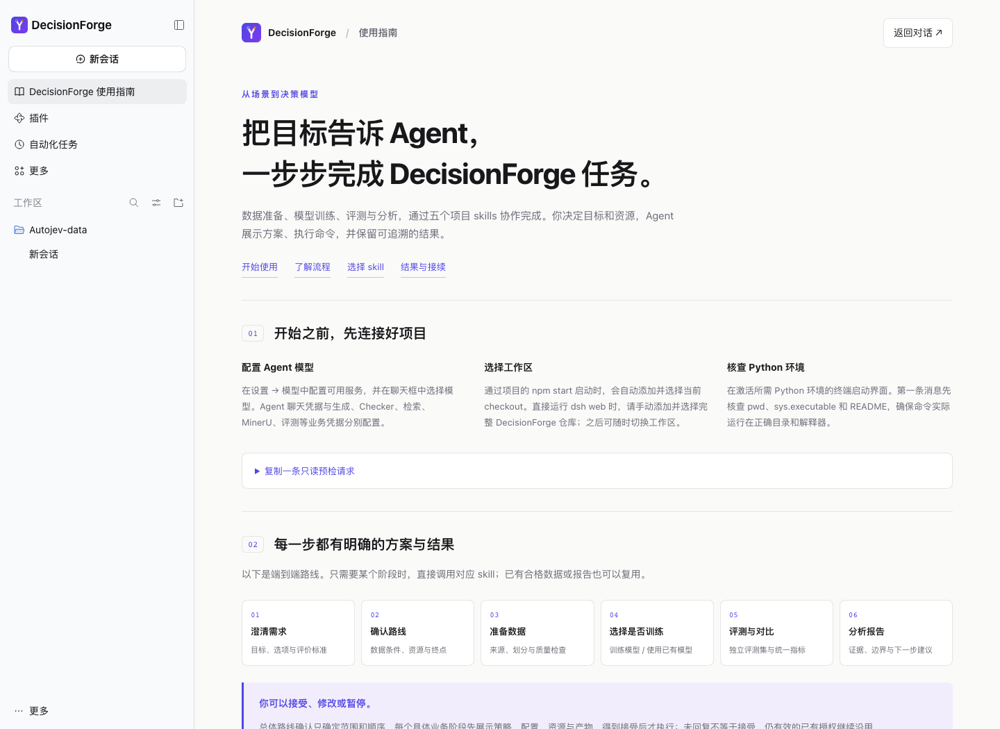

# 通过 Agent 使用

[English](../en/agent.md) · [README](../../README.md)

推荐使用 dsh 加 DecisionForge 插件，或在仓库内使用自己的 coding agent。模型对话凭据与数据生成、训练、评测服务的凭据分别配置。

## dsh 加插件

准备 Node >=24.9、npm、PATH 中可用的 pnpm，并先完成 [Python 安装](quickstart.md)。插件固定兼容 DeepSeek Harness 0.2.2-rc.1。

```bash
npm ci --prefix extensions/dsh-decisionforge
npm run register --prefix extensions/dsh-decisionforge
npm start --prefix extensions/dsh-decisionforge
```

注册通过 dsh 原生插件管理安装本地 tarball；日常启动不重复安装。安装和启动须使用同一 `DSH_HOME` 与 web profile。项目启动器自动添加并选择当前 checkout；直接运行 `dsh web` 时手动选择完整仓库。先在设置中配置 Agent 模型，再输入：

```text
/dforge 我想把现有场景整理成可评测的决策任务，请先核查项目和输入。
```



侧栏和欢迎页 Logo 打开使用指南。指南跟随 dsh 中英文设置切换，支持浅色与深色主题。插件可以通过原生插件页启停、移除；停用恢复上游品牌，不删除任务与聊天。其他 profile 需单独安装；插件当前不发布 npm。



完整打包、安装与卸载说明见 [插件 README](../../extensions/dsh-decisionforge/README.md)。

## 自己的 coding agent

在仓库根目录启动 Codex 或 Claude Code。五个 Skills 位于 `.agents/skills/`；Claude 通过 `.claude/skills/` 的项目软链接发现。先核查工作目录、Python 解释器和 README，确保 agent 使用当前 checkout。

| Skill | 任务 |
| --- | --- |
| `/dforge` | 需求澄清、适用性、路线与接续 |
| `/dforge-data` | 来源研究、输入整理、生成与检查 |
| `/dforge-train` | 配置、启动、跟进与恢复训练 |
| `/dforge-eval` | 已有模型评测、比较与重评分 |
| `/dforge-analyze` | 数据、训练、评测证据分析 |

已有数据先固定独立评测集，再研究训练来源；只有场景先建立数据和评测依据，再选择训练或已有模型。明确的单阶段请求只执行相应阶段，不强制补全全流程。

每个业务阶段展示策略、配置、资源、预算和产物后执行，沿用仍有效的已有授权。任务目录 `outputs/tasks/<task>/` 中的 README.md 与 task.json 保存实际决定、授权、作业与产物。恢复先读任务记录、检查进程/manifest/输出，避免重复提交；停止 Agent 回复不一定终止后台训练。

流程源文件：[端到端](../assets/workflow.mmd) · [阶段确认](../assets/stage-confirmation.mmd)。
