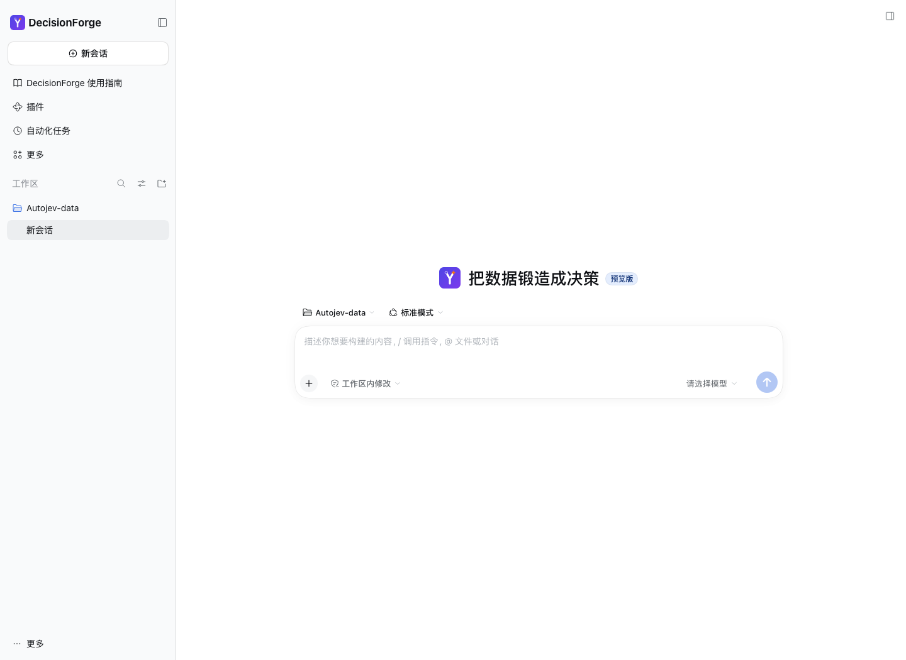
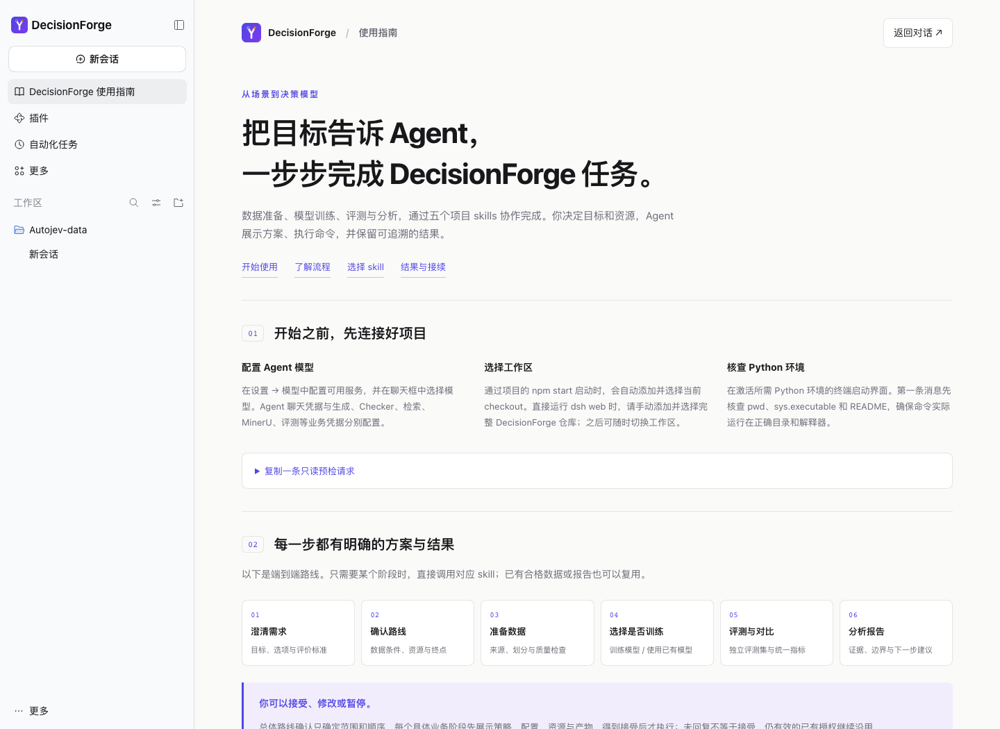

# DecisionForge 原生 dsh 插件

第一次使用完整项目：先看 **[Agent 快速开始](../../docs/zh/agent.md)**。

`@decisionforge/dsh-plugin` 通过 **`dsh.bundle` 原生插件机制** 注册到 DeepSeek Harness，为 Web UI 添加 DecisionForge Logo、名称和中英文使用指南。安装后在 **插件 → DecisionForge** 中查看说明、启用、停用或卸载；普通 `dsh web` 启动即可加载，不再依赖临时 overlay 或自定义聊天前端。

兼容 **dsh 0.2.2-rc.1**，要求 **Node >=24.9.0**、npm 和 **pnpm 可执行文件在 PATH**。当前没有发布到公共 npm registry；通过构建后的 tarball 安装。插件本身无需 Python，但运行 DecisionForge 业务仍需完整仓库及正确 Python 环境。

## 在本仓库注册并启动

在完整 DecisionForge checkout 根目录运行：

```bash
npm ci --prefix extensions/dsh-decisionforge
npm run register --prefix extensions/dsh-decisionforge
npm start --prefix extensions/dsh-decisionforge
```

`register` 先构建插件，再将 tarball 写入 `extensions/dsh-decisionforge/dist/`，然后调用官方 `dsh plugin --profile web add <tarball>`。安装位置由 `DSH_HOME` 决定（默认 `~/.dsh`），原生包管理负责写入 profile 依赖和 `dsh.profile.bundles`；启动器不直接编辑这些文件。日常启动不执行安装，不再使用 `--patch` 加载本插件。

项目启动器根据自己的位置解析 checkout 根目录，传给插件，插件通过原生 workspaceRegistry 注册或复用工作区，并在浏览器首次载入时选中该项目，覆盖上次保存的其他工作区选择。克隆、移动或重命名项目目录后，仍使用当前 checkout，路径可含空格。每次载入只自动选择一次，之后可以自由切换；如果用户在加载完成前已经开始操作，取消待执行的自动选择。插件停用时不执行自动选择。

安装与启动使用同一 `DSH_HOME` 和 profile。若使用独立状态目录，先 `export DSH_HOME=/absolute/path/dsh-home`，再执行上述命令。若 dsh 已在运行，安装后按界面提示重启同一 profile。不要再保留旧的 DecisionForge `--patch` overlay，否则它的高优先级可能让原生停用开关失效。

可透传 Web CLI 参数：

```bash
npm start --prefix extensions/dsh-decisionforge -- --no-open --port 3080
```

也可在激活 Python 的终端进入所需仓库，直接运行 `npx --yes @deepseek-ai/dsh@0.2.2-rc.1 web`。两种启动方式都读取同一个已注册插件；项目启动器会自动添加并选择它所属的 checkout，直接运行官方命令时沿用 dsh 自身的工作区恢复逻辑。

## 分享给已有 dsh 的使用者

把 `dist/decisionforge-dsh-plugin-0.3.0.tgz` 交给使用者。该文件包含运行产物、Logo、注册清单、中英文插件说明，不需要你的源码目录或 node_modules。

在使用者的 **插件 → 添加插件** 中输入 tarball 的**绝对路径**，完成原生安装；也可在使用者自己的终端运行：

```bash
dsh plugin --profile web add /absolute/path/decisionforge-dsh-plugin-0.3.0.tgz
dsh web
```

未全局安装 CLI 时使用固定版本：

```bash
npx --yes @deepseek-ai/dsh@0.2.2-rc.1 plugin --profile web add /absolute/path/decisionforge-dsh-plugin-0.3.0.tgz
npx --yes @deepseek-ai/dsh@0.2.2-rc.1 web
```

其他具备 Web UI 原生 slots 的 profile 将 `web` 换成其实际名称，并在相同 profile 启动。安装到 Web 不会自动安装到另一个 Desktop profile。`engines.dsh` 固定兼容范围，其他版本需验证后再支持。

## 使用、停用与卸载

安装后打开 **插件 → DecisionForge**，查看版本、说明和启用状态。点击侧栏 **DecisionForge 使用指南** 或对话首页 Logo 打开指南；复制示例后返回聊天修改并发送。

通过项目启动器自动进入，或手动添加并选择完整 DecisionForge 仓库作为 workspace 后，原生 skills provider 才会发现 `.agents/skills/` 中的五个入口。本插件介绍这些 skills，但不全局安装或复制它们，不自动配置模型密钥或执行业务任务。完整模型、Python、workspace、SSH 与接续操作见 [Agent 接入教程](../../docs/zh/agent.md)。

在原生插件页关闭 **DecisionForge**：移除指南并恢复上游品牌；重新打开可恢复。点击详情中的 **移除** 卸载，或先停止对应 profile 后执行：

```bash
dsh plugin --profile web remove @decisionforge/dsh-plugin
```

若管理页提示需要重启，重启后生效。停用或卸载不会删除聊天、任务目录和模型配置。仅改用官方启动命令不会停用已经注册的插件。

## 开发与打包

```bash
npm run build --prefix extensions/dsh-decisionforge
npm test --prefix extensions/dsh-decisionforge
cd extensions/dsh-decisionforge
npm pack --dry-run
npm pack
```

改动代码后重新打包。更新本地 tarball 时，停止 profile，通过原生命令移除旧版再安装新包，避免相同版本的本地快照继续使用旧产物。原生 CLI 要求 pnpm；若提示找不到，先安装适合当前 Node 的 pnpm，再重试。运行库内已包含 Logo 和样式，无安装时构建脚本。

- `cordis.patch.yml` 声明官方品牌替换和本包的可卸载插件条目。
- `package.json` 的 `dsh.bundle` 负责原生注册，`dsh.client` 和 `./client` 负责浏览器扩展。
- `locale/` 与 `docs/DETAIL*` 提供插件页中英文元数据及说明。
- `src/index.js` 使用原生工作区注册和鉴权路由；`src/launch-workspace.js` 等待原生列表就绪后执行一次工作区导航。
- `src/content.js` 维护指南；`src/client.js` 注册原生 slots；样式作用于插件自身类，并对固定上游版本的首页标题做条件隐藏。

首页 slogan 为「每个场景，都值得一个决策模型」。上游没有标题 slot，因此在原生品牌 slot 中渲染真实文本，仅在插件品牌存在时隐藏固定版本的原标题；停用自动恢复。升级 dsh 时需重新核查标题结构。浏览器标题、favicon、预览版和模型登录提示仍由上游提供。插件不修改上游源码。采用 Apache-2.0 许可证。指南与欢迎页跟随 dsh 语言设置即时切换。




